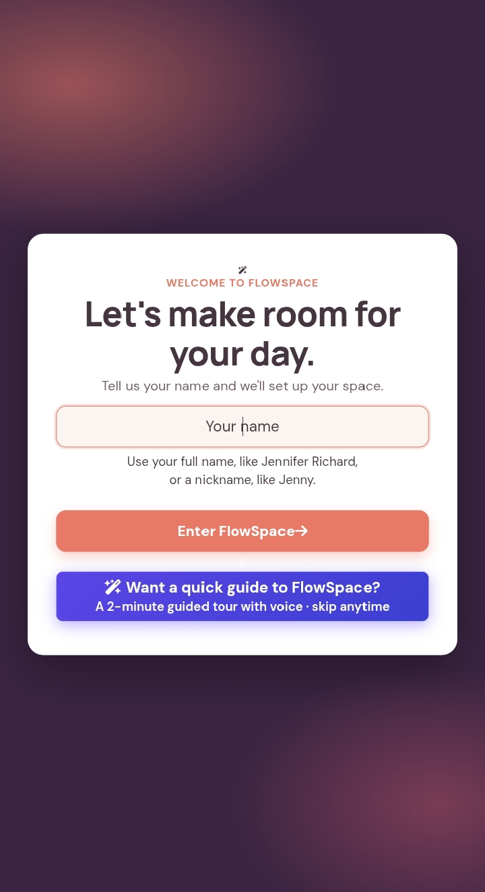
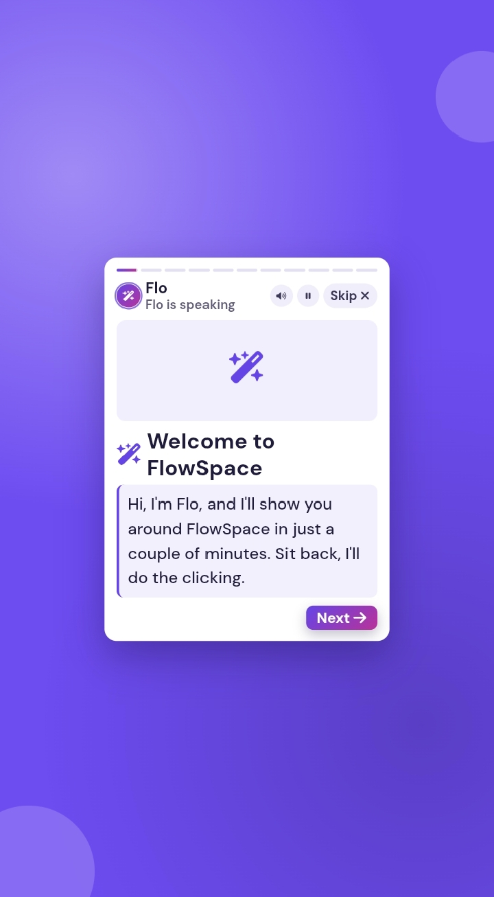
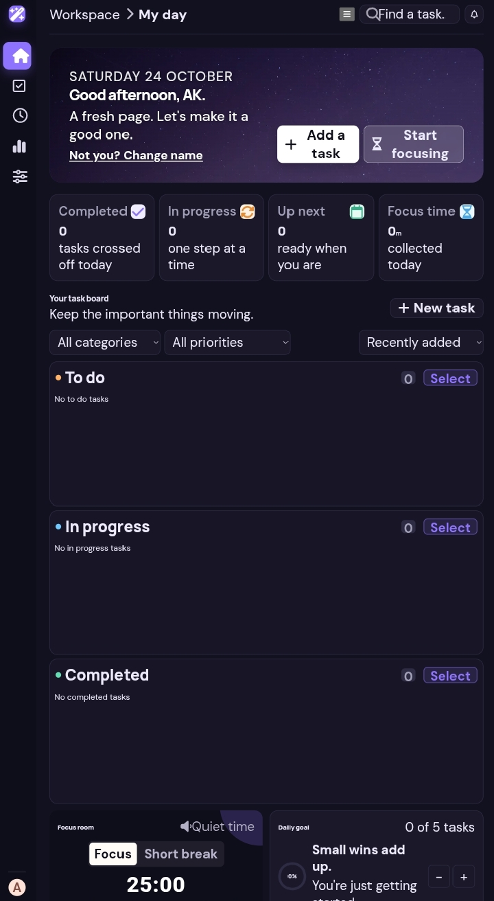
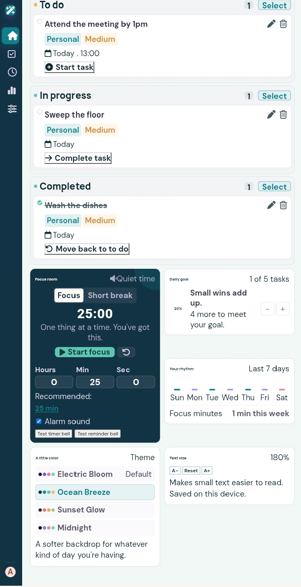

# FlowSpace

FlowSpace is a personal productivity dashboard that helps you plan your day, stay focused and see your progress. It brings a task board, due dates and times, reminders, focus and break timers, daily goals and a seven-day activity chart together in one colourful space that you can personalise. A friendly built-in guide, Flo, shows new users around.

- **Live demo:** https://omoakin1-devburn.github.io/FlowSpace/
- **Repository:** https://github.com/OMOAKIN1-devburn/FlowSpace

## Screenshots

<table>
  <tr>
    <td align="center" width="25%"><br><sub>Welcome screen with the guide button</sub></td>
    <td align="center" width="25%"><br><sub>Guided tour with Flo</sub></td>
    <td align="center" width="25%"><br><sub>Dashboard in the Midnight theme</sub></td>
    <td align="center" width="25%"><br><sub>Task board, focus room and settings in Ocean Breeze</sub></td>
  </tr>
</table>

## Contents

- [Screenshots](#screenshots)
- [Quick start](#quick-start)
- [Features](#features)
- [Technologies](#technologies)
- [Project structure](#project-structure)
- [Run locally](#run-locally)
- [Good to know](#good-to-know)
- [What's new: improvements and fixes](#whats-new-improvements-and-fixes)
- [Testing checklist](#testing-checklist)

## Quick start

1. Open FlowSpace and enter your name, for example `Jennifer Richards` or a nickname like `Jenny`. Not sure how things work? Press **Want a quick guide to FlowSpace?** for a short guided tour with voice.
2. Press **Add a task**, give it a name, a category and a priority, and choose a due date and time if you like.
3. Move tasks along from **To do** to **In progress** to **Completed**, or drag them between columns.
4. Open the **Focus room**, choose any length of time, and start a focus session.
5. Make it yours in **Preferences**: pick a theme and change the text size.

## Features

### Tasks

- Create, edit, delete and complete tasks.
- Three columns: **To do**, **In progress** and **Completed**. Move tasks with a button, the tick circle, or drag and drop. Drag and drop works with a mouse and by touch (press and hold on phones and tablets).
- Organise tasks with categories (Personal, Work, Wellbeing, Learning, or your own), priorities (Low, Medium, High), search, filters and sorting by recently added, due date or priority.
- **Bulk deletion:** press **Select** on a column, tick the tasks you want to remove and delete them together. Selection stays within that column, and FlowSpace asks for confirmation first because deleted tasks cannot be brought back.
- **Spelling help:** the browser underlines misspelled words, and FlowSpace offers a "Did you mean…?" suggestion for common task words, using Levenshtein distance. Short or unusual words are left alone.
- **Reset board:** restore the starter tasks at any time, after a confirmation.

### Dates, times and reminders

- Set a due date and a due time, down to the second.
- **Due in:** enter hours, minutes and seconds from now and FlowSpace works out the date and time for you, even when it lands tomorrow.
- **Remind me:** at the due time, 10 minutes before, or 1 hour before. A reminder shows an on-screen message, plays the reminder bell, and sends a desktop notification if you have allowed notifications.
- Tasks past their due time are marked as overdue, and sorting by due date takes the time into account.

### Focus room

- **Focus** and **Short break** timers of any length, in hours, minutes and seconds. One click on **Recommended** sets 25 minutes for focus and 5 minutes for a break.
- Start, pause, resume and reset. The countdown also shows in the browser tab title while the timer runs.
- An alarm bell rings when a session ends. Sound can be switched off, and **Test timer bell** and **Test reminder bell** buttons let you check your volume.
- Timer settings are remembered between visits, and completed focus minutes are added to your daily total.

### Progress

- Live statistics for tasks completed today, tasks in progress, tasks coming up and focus time.
- An adjustable **daily goal** with a progress ring.
- **Your rhythm:** a seven-day chart of focus minutes.

### Personalise and accessibility

- Four themes: **Electric Bloom**, **Ocean Breeze**, **Sunset Glow** and **Midnight**. Your choice is saved and applied before the page appears, so there is no flash of the wrong colours.
- **Text size** controls (A−, Reset, A+) make the interface text smaller or larger. Small text starts at a comfortable reading size, and secondary text is dark enough to read in every theme.
- Keyboard-accessible dialogs, labelled controls, visible focus outlines and reduced-motion support.
- Hover effects appear only on devices with a mouse, so touch screens never get stuck on a hover colour.

### Welcome screen and guided tour

- The welcome screen asks for your name and personalises the greeting. **Not you? Change name** and **Keep my current name** are always available. It appears again on a new visit, but not when you simply refresh.
- **Want a quick guide to FlowSpace?** opens a full-screen tour of 11 short steps hosted by **Flo**: your name, adding tasks, dates and reminders, moving and dragging tasks, bulk delete, the focus room, themes and text size, and the menu.
- Flo speaks using the device's built-in voice while the captions type out, and the tour moves on by itself. Controls: pause and play, voice on and off, Back and Next, progress bars you can tap, and Skip. Arrow keys move between steps and Esc closes the tour. At the end you can **watch again** or **proceed** to the app.

### Navigation and layout

- Sidebar with **My day**, **My tasks**, **Focus room**, **Insights** and **Preferences**. It scrolls on short windows.
- On small screens, the hamburger button opens a **Go to** menu that jumps straight to each section.
- Responsive layouts for desktop, tablet and phone, including phones that use Desktop site mode.

## Technologies

- HTML5, CSS3 and vanilla JavaScript (ES modules). No framework, backend or database.
- Browser `localStorage` for tasks, name, theme, text size, goals, timer settings and focus activity.
- Web Speech API for Flo's voice, Web Audio API for the alarm bells and the Notifications API for reminders.
- Font Awesome for icons (offline copy included) and DM Sans and Manrope from Google Fonts for typography.
- Vite for the development server and production build.

## Project structure

```text
FlowSpace/
├── index.html
├── src/
│   ├── flowspace.css   layout, themes and components
│   ├── flowspace.js    tasks, timer, reminders, themes and text size
│   ├── guide.css       welcome-page guide styles
│   └── guide.js        guided tour with Flo
├── docs/               screenshots used in this README
├── css/ and webfonts/  offline copy of Font Awesome
├── vite.config.ts
├── package.json
└── README.md
```

## Run locally

**With Node.js and Vite**

1. Install Node.js.
2. From the project folder, run `npm install`.
3. Run `npm run dev`, then open the local address printed in your terminal.
4. Run `npm run build` to create a production build in `dist/public`.

If you host the build under a sub-path, such as GitHub Pages at `/FlowSpace/`, set `BASE_PATH` before building. In PowerShell: `$env:BASE_PATH="/FlowSpace/"; npm run build`.

**With VS Code Live Server**

1. Open the folder in VS Code and choose **Go Live**.
2. Open `http://127.0.0.1:5500/FlowSpace/index.html`, adjusting the path to where your folder sits.

Open the project through a server like these. Double-clicking `index.html` will not work, because the scripts are ES modules.

FlowSpace stores everything in your browser, so no database or backend setup is needed. An internet connection is only used for the Google Fonts. If they cannot load, the page falls back to your system fonts.

## Good to know

- Reminders and timers run while FlowSpace is open in a browser tab. A closed page cannot send notifications.
- Desktop notifications need your permission, which the browser asks for the first time you set a reminder.
- Browsers only start sound after you tap or click the page. On phones, turn off silent mode and turn the volume up to hear Flo and the bells.
- Flo's voice comes from the voices installed on the device, so it sounds different on Windows, Android and iPhone. The captions are always shown, and the tour carries on without sound if a voice is not available. To use your own recordings, list the audio files in the `AUDIO` list at the top of `src/guide.js` and place them in a `guide/` folder next to `index.html`.
- Data belongs to one browser on one device. Clearing the site data removes your tasks and settings.
- To see the welcome screen again after your first visit, open FlowSpace in a new tab or a private window.

## What's new: improvements and fixes

**Added**

- Due times with seconds, the **Due in** countdown and reminders with notifications.
- Focus and break timers of any length, with alarm bells and test buttons.
- Bulk selection and deletion with confirmation, and drag and drop with touch support.
- Spelling suggestions, a fourth theme (Midnight), and text size controls (A−, Reset and A+).
- Welcome screen with personalised greeting, and the Flo guided tour with voice.
- Hamburger **Go to** menu with working navigation, and a scrolling sidebar for short windows.

**Fixed**

- Page head tags (viewport, theme colour and icon) so phones scale the page correctly.
- A board crash caused by an invalid time value.
- Tasks being saved twice when **Add task** was pressed repeatedly.
- Spelling suggestions changing correct words, and the browser's saved-entries list covering the suggestion.
- Timer boxes rewriting what you type, for example turning `0` into `1`.
- Alarm sound being blocked until the first click, and Flo being slow to start speaking on phones.
- Guide card colours and text visibility, and the hamburger menu links not navigating.
- Hover and click colours that stayed behind after use, now mouse-only and returning to normal.
- Faint grey text and low-contrast colours across the Ocean Breeze, Sunset Glow and Midnight themes.
- Double font loading, a stray debug message, and missing chart labels for screen readers.

## Testing checklist

- [ ] Check the layout on desktop, tablet and phone screen sizes, including a phone in Desktop site mode.
- [ ] Open FlowSpace in a new tab: enter a name, use **Change name**, and confirm the greeting updates everywhere.
- [ ] Play the guided tour with voice, with the voice off, and with pause, Back, Next and Skip. Try it on a phone.
- [ ] Create, edit, complete, reopen and delete tasks, including a task with a misspelled name.
- [ ] Move tasks between To do, In progress and Completed, with buttons and by drag and drop (mouse and touch).
- [ ] Test search, category and priority filters, sorting and due dates.
- [ ] Select several tasks in a column and check that bulk deletion asks for confirmation and removes only the selected tasks.
- [ ] Use **Reset board** and confirm it asks first and then restores the starter tasks.
- [ ] Add tasks with a due time and with **Due in**, set each reminder option, and confirm alerts arrive at the right time.
- [ ] Start, pause, resume and reset the focus and break timers with different durations, and type `0` into the boxes to confirm nothing jumps back.
- [ ] Confirm the timer bell and reminder bell sound, and that turning sound off silences them.
- [ ] Change the text size across the whole range, check the Reset control, and reload to confirm it is remembered.
- [ ] Adjust the daily goal and check the statistics, progress ring and seven-day chart.
- [ ] Switch between all four themes, reload the page, and confirm text stays easy to read.
- [ ] Open the hamburger menu on a small screen and confirm every item jumps to the right section.
- [ ] Reload the dashboard and verify that tasks, goals, timer settings and activity data persist.
- [ ] Check keyboard navigation, dialog focus and reduced-motion behaviour.
